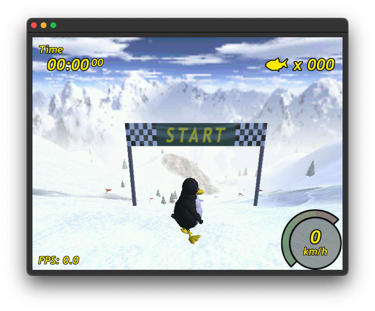
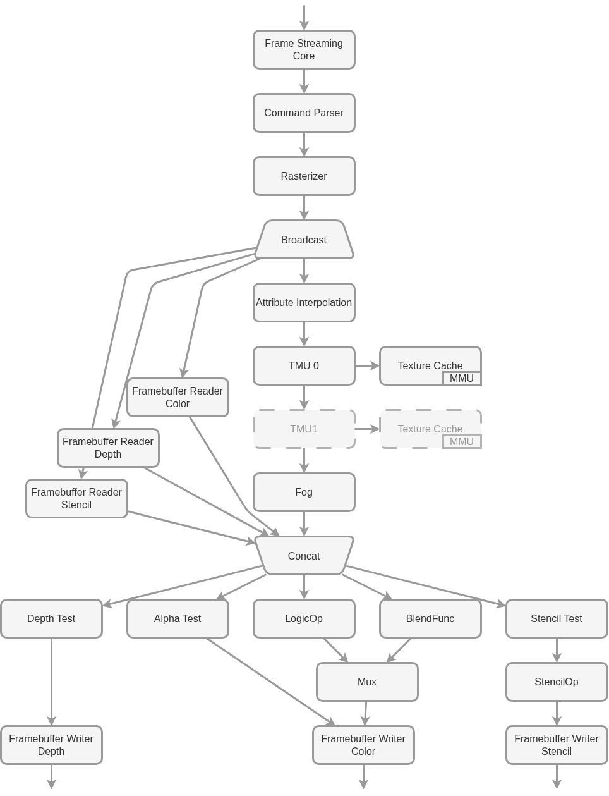
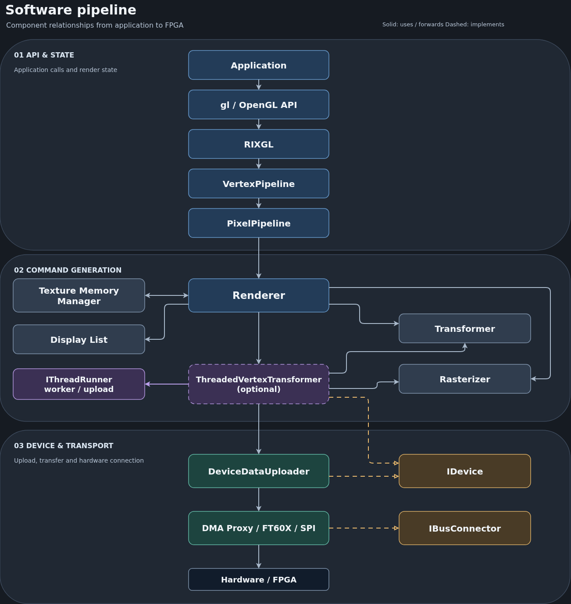

# RasterIX

**An open-source, fixed-function 3D rasterizer for FPGA-based systems.** RasterIX pairs a C++ graphics driver and software vertex pipeline with a Verilog pixel-rendering core. It is designed for embedded systems where a dedicated, configurable graphics pipeline is useful.

| | |
|---|---|
| Graphics API | OpenGL ES 1.1-oriented fixed-function rendering, with selected OpenGL 1.3 additions; this is not a complete conformance implementation. |
| Hardware | FPGA rasterization, up to two texture mapping units (TMUs), external or internal framebuffer variants. |
| Software | C++17 driver, vertex processing, device upload/streaming, simulation connectors, and a software rasterizer. |
| License | [GNU GPL v3 or later](LICENSE). |

## About the project

RasterIX began as an experiment in implementing a 3D graphics renderer in FPGA logic. The goal is an open, and OpenGL compatible fixed-function renderer for embedded Linux and microcontroller-class systems and not a programmable shader GPU. The work has achieved a FPGA pixel pipeline with internal / external framebuffer variants, a C++ OpenGL-oriented driver and software vertex pipeline, up to two TMUs, device streaming, simulation, platform connectors, and example integrations.

The hardware accelerates pixel work. The C++ driver performs the OpenGL state management and vertex pipeline, then streams rendering commands and data to the core. The project has been used with FPGA development boards, Linux systems, and MCU-based integrations. Exact API coverage, features, and game compatibility depend on the selected build and hardware configuration.

**Theoretical peak throughput:** the datapath is designed for up to one completed pixel per clock, with one texture operation per pixel for each enabled TMU. At a 100 MHz core clock, that corresponds to an idealized ceiling of **100 MPixels/s** and up to **200 MTexel operations/s** with two TMUs (100 MTexel operations/s with one TMU). These are calculated core-level peaks and not measured benchmark results or guaranteed sustained rates. Clock frequency, framebuffer/texture memory throughput, overdraw, and pipeline stalls reduce real application throughput.

## Working games

Tested games are:

- [Tux Racer](https://github.com/ToNi3141/tuxracer.git), statically linked.
- [Quake 3 Arena / Quake3e](https://github.com/ToNi3141/Quake3e), using SDL2 and glX.
- Warcraft 3, using WGL.



<video src="https://github.com/user-attachments/assets/909e6167-abf3-4c31-8bfd-f250dc2a8f0c" width="1024" height="500" controls></video>

## FPGA utilization

The following are the latest checked-in **post-route whole-design** reports located with the Arty Z7-20 and TE0890 builds. They report the complete design, not an isolated core. Both were generated with Vivado 2022.2. Resource percentages are relative to the target FPGA shown.

### Board configurations represented by the reports

| Board | Configured features |
|---|---|
| Arty Z7-20 (`xc7z020clg400-1`) | External framebuffer; 1 TMU; 64-bit AXI; 18-bit fixed-point interpolation precision; 256×256 maximum texture dimension; 8 KiB texture cache enabled; 2048-byte pages; mipmapping, filtering, fog, depth, stencil, and memory coalescing enabled. The generated IP configuration is authoritative; the board guide’s texture-storage row is outdated. Runs at 100MHz. |
| TE0890 (`xc7s25ftgb196-1`) | External framebuffer; 1 TMU; 16-bit AXI; 18-bit fixed-point precision; 6-bit sub-pixel precision; 128×128 maximum texture dimension; 8 KiB texture cache enabled; 2048-byte pages; mipmapping, filtering, fog, depth, stencil, and memory coalescing enabled. HyperRAM runs at 75 MHz. |

### Post-route results

| Board/report date | LUTs | Registers | BRAM tiles | DSPs |
|---|---:|---:|---:|---:|
| Arty Z7-20 | 15,446 / 53,200 (**29.03%**) | 15,899 / 106,400 (**14.94%**) | 17.5 / 140 (**12.50%**) | 19 / 220 (**8.64%**) |
| TE0890 | 10,708 / 14,600 (**73.34%**) | 10,940 / 29,200 (**37.47%**) | 12.5 / 45 (**27.78%**) | 19 / 80 (**23.75%**) |

## Checkout and build

Clone the repository with its RTL and library submodules:

```sh
git clone --recurse-submodules https://github.com/ToNi3141/RasterIX.git
cd RasterIX
```

The checked-in CMake presets require **CMake 3.23 or newer**. Configure/build presets for host and embedded environments include:

| Preset | Purpose / notes |
|---|---|
| `native_rixif`, `native_rixef` | Native desktop build with examples and the FT60X driver selected; install the FTDI/FT60X dependencies required by the build. Designed to be used with [Nexys Video platform guide](rtl/top/Xilinx/NexysVideo/README.md). |
| `zynq_embedded_linux_rixef` | Zynq embedded Linux build; requires the matching cross toolchain and PetaLinux SDK/sysroots. See the [Arty guide](rtl/top/Xilinx/ArtyZ7-20/README.md). |
| `rppico` | Raspberry Pi Pico SDK base configuration is marked hidden in CMake and is not a directly selectable preset. Pico SDK and PlatformIO integration are documented in the [TE0890 guide](rtl/top/Xilinx/te0890/README.md); its PlatformIO example is available for direct integration. |
| `win32_sw` | 32-bit Windows WGL software-rasterizer build using Visual Studio. |
| `win32_rixif`, `win32_rixef` | Native windows build with examples and the FT60X driver selected; install the FTDI/FT60X dependencies required by the build. Designed to be used with [Nexys Video platform guide](rtl/top/Xilinx/NexysVideo/README.md). |
| `unittest_software`, `unittest_verilator` | Software unit tests and RTL tests driven by Verilator, respectively. |

Example win32 build (requires the FT60X/FTDI dependencies enabled by the preset):

```sh
cmake --preset win32_rixef
cmake --build build/win32 --parallel
```

Example software test build:

```sh
cmake --preset unittest_software
cmake --build build/unittest-software --parallel
ctest --test-dir build/unittest-software --output-on-failure
```

For RTL simulation, install Verilator, then use the `unittest_verilator` preset and run CTest in `build/unittest-verilator`. The workspace’s historical test logs may not reflect the current source state.

For Zynq, initialize the PetaLinux SDK and set `SYSROOTS` to its sysroots directory before configuring. For Pico, select the board as required by your SDK (for example, `-DPICO_BOARD=pico2`). Consult each platform guide for tool installation, FPGA programming, and board-specific setup.

## Platforms

### FPGA and simulation targets

- [Verilator simulation](rtl/top/Verilator/README.md)
- [Digilent Nexys Video](rtl/top/Xilinx/NexysVideo/README.md)
- [Trenz Electronic TE0890](rtl/top/Xilinx/te0890/README.md)
- [Digilent Arty Z7-20](rtl/top/Xilinx/ArtyZ7-20/README.md)

### Software build and integration environments

- Win32 desktop builds and Windows WGL are defined by the CMake presets.
- Zynq embedded Linux uses the DMA Proxy driver and a PetaLinux cross-build environment.
- Raspberry Pi Pico SDK and PlatformIO integration examples are documented with the TE0890 project.
- Verilator supports RTL simulation; the CMake test presets cover software and RTL unit tests.

## Use the driver in a new software environment

RasterIX is built with CMake and C++17. The library target is `gl`. The repository’s CMake configuration selects platform drivers and thread wrappers (`threadrunner`). To integrate it into an existing product, use the repository’s targets or mirror the required source, dependency, compile-definition, and configuration settings in your build. The `example/util/` directory contains platform composition examples.

CMake also has top-level switches for selecting the host build and optional components:

| CMake option | Purpose |
|---|---|
| `RIX_BUILD_NATIVE`, `RIX_BUILD_ZYNQ_EMBEDDED_LINUX`, `RIX_BUILD_RPPICO` | Select the desktop, Zynq embedded Linux, or Pico SDK build path. |
| `RIX_DRIVER_FT60X`, `RIX_DRIVER_DMA_PROXY`, `RIX_DRIVER_STANDALONE_XIL_CDMA`, `RIX_DRIVER_VERILATOR`, `RIX_DRIVER_SOFTWARE_RASTERIZER` | Include the selected hardware/simulation/software bus connector. |
| `RIX_BUILD_EXAMPLES` | Build example applications. |
| `RIX_BUILD_TESTS_SOFTWARE`, `RIX_BUILD_TESTS_VERILATOR` | Enable software or Verilator test targets. |
| `RIX_BUILD_SHARED_LIBRARY` | Build a shared library when supported by the platform configuration. |
| `RIX_ENABLE_SPDLOG` | Enable spdlog logging. |

### Minimal application integration

Integration has two parts: configure/link the RasterIX CMake targets, then create the device and use it from the application. The example uses `DMAProxyBusConnector`; substitute your platform's connector if needed.

#### 1. Configure and statically link the CMake targets

Set the driver and `RIX_CORE_*` cache variables **before** `add_subdirectory()`. Then link `gl` and the selected connector's target to the application (skip it when you want to link against a shared library):

```cmake
# Enable this only when using the Linux DMA Proxy connector shown below. Can be omitted when you use your own.
set(RIX_DRIVER_DMA_PROXY ON CACHE BOOL "Build the DMA Proxy connector")

# Example one-TMU software configuration (480x320 render target).
# Match capability values to the parameters in the FPGA design.
set(RIX_CORE_TMU_COUNT "1" CACHE STRING "Hardware TMU count")
set(RIX_CORE_TEXTURE_BUFFER_MAX_TEXTURE_SIZE "256" CACHE STRING "Maximum texture dimension")
set(RIX_CORE_ENABLE_MIPMAPPING "true" CACHE STRING "Enable mipmapping")
set(RIX_CORE_TEXTURE_PAGE_SIZE "2048" CACHE STRING "Texture page size in bytes")
set(RIX_CORE_MAX_DISPLAY_WIDTH "480" CACHE STRING "Maximum render width")
set(RIX_CORE_MAX_DISPLAY_HEIGHT "320" CACHE STRING "Maximum render height")
set(RIX_CORE_IF_FRAMEBUFFER_SIZE_IN_PIXEL_LG "20" CACHE STRING "IF framebuffer capacity / EF display splitting")
set(RIX_CORE_THREADED_RASTERIZATION "false" CACHE STRING "Use direct, non-threaded device setup below")

add_subdirectory(external/RasterIX)

add_executable(my_app main.cpp)
target_link_libraries(my_app PRIVATE gl spdlog::spdlog dmaproxy span)
```

`external/RasterIX` is the repository checkout path. These example values must be adjusted to match the FPGA configuration; set memory addresses and other platform-specific options as described in [Parameters: software and FPGA](#parameters-software-and-fpga). With your own connector, omit the DMA Proxy option and replace `dmaproxy` in the link list with your connector target.

#### 2. Create the device and submit frames

Construct the connector and uploader, create the `RIXGL` instance with the device, and set the render size. Put your OpenGL drawing calls in the scene's `draw()` method and submit each frame with `swapDisplayList()`:

```cpp
constexpr std::size_t width = 480;
constexpr std::size_t height = 320;
MyScene scene;
rr::DMAProxyBusConnector bus;
rr::devicedatauploader::DeviceDataUploader device { bus };

rr::RIXGL::createInstance(device);
rr::RIXGL::getInstance().setRenderResolution(width, height);

scene.init(width, height);
while (scene.isRunning())
{
    scene.draw(); // Issue OpenGL calls for this frame.
    rr::RIXGL::getInstance().swapDisplayList(); // Submit this frame to the device.
}

rr::RIXGL::destroy();
```

This direct-device setup requires `RIX_CORE_THREADED_RASTERIZATION=false`. Keep `bus` and `device` alive until after `RIXGL::destroy()`. For the threaded `ThreadedVertexTransformer` composition and a complete platform example, see the Zynq [`Runner.hpp`](example/util/zynq-embedded-linux/Runner.hpp).


### Porting the device transport

Implement `rr::IBusConnector` for the target transport (for example DMA, SPI, USB, or a memory-mapped interface). The indexed buffers must meet the transport’s alignment/capability needs. `writeData()` and `readData()` transfer the requested byte count. They automatically block when the prior transfer wasn't finished. `blockUntilTransferIsComplete()` blocks as long as any transfer is ongoing.

```cpp
class IBusConnector
{
public:
    virtual ~IBusConnector() = default;
    virtual void writeData(uint8_t index, uint32_t size, uint32_t offset = 0) = 0;
    virtual void readData(uint8_t index, uint32_t size) = 0;
    virtual void blockUntilTransferIsComplete() = 0;
    virtual tcb::span<uint8_t> requestWriteBuffer(uint8_t index) = 0;
    virtual tcb::span<uint8_t> requestReadBuffer(uint8_t index) = 0;
    virtual uint8_t getWriteBufferCount() const = 0;
    virtual uint8_t getReadBufferCount() const = 0;
};
```

The interface lives in [`lib/gl/IBusConnector.hpp`](lib/gl/IBusConnector.hpp). Existing connectors are platform-specific. There might be reused, but typically a new platform must implement their own connector. See [`lib/driver`](lib/driver) for a few examples.

### Thread execution

Implement `rr::IThreadRunner` when the platform needs a custom worker scheduler:

```cpp
class IThreadRunner
{
public:
    virtual ~IThreadRunner() = default;
    virtual void wait() = 0;
    virtual void run(const std::function<void()>& operation) = 0;
    virtual bool isBusy() const = 0;
};
```

`StdThreadRunner` uses `std::thread` with a single worker; a call to `run()` waits until its prior operation is complete before scheduling the next. Use it only where the standard threading runtime is available and useful. `NoThreadRunner` executes the operation inline and can be used on a platform without threads. The Pico example provides a platform-specific runner. Other multicore MCUs may need their own implementation to use additional cores. See [`lib/threadrunner/`](lib/threadrunner/) and [`example/util/`](example/util/).

### Driver configuration

Set the software configuration described in [Parameters: software and FPGA](#parameters-software-and-fpga). For PlatformIO or another non-CMake build, provide the same `RIX_CORE_*` compile definitions; see the [TE0890 PlatformIO example](rtl/top/Xilinx/te0890/README.md#platformio).

## Use the RTL core in a new project

Add the RTL under `rtl/RasterIX/` and the required dependencies under `rtl/3rdParty/` and `rtl/Float/rtl/float/` to your FPGA project. Use [`RasterIX.v`](rtl/RasterIX/RasterIX.v) as the public wrapper.

At minimum, integrate:

1. `aclk` and active-low `resetn`.
2. The 32-bit AXI-Stream command input (`s_cmd_axis_*`) and command-response output (`m_cmd_resp_axis_*`). The host connector/device uploader constructs this stream.
3. The AXI memory master interface (`m_axi_*`) to memory capable of serving framebuffer and texture/device-memory requests.
4. The framebuffer swap handshake (`swap_fb`, `swap_fb_enable_vsync`, `fb_addr`, `fb_size`, and `fb_swapped`) are used to connect a display and do the framebuffer swap. See [rtl/Display](rtl/Display/) for examples and see the different platforms how they integrate.
5. Optionally, performance outputs such as `perfBusy`, `perfTriangleRendering`, and `perfRasterizerStall` for instrumentation.

The RTL wrapper’s parameters and the required software/RTL matches are summarized in [Parameters: software and FPGA](#parameters-software-and-fpga).

## Core variants

The RTL has two framebuffer variants. **Use EF (`VARIANT="ef"`) when possible; IF is not recommended for new designs unless its internal-framebuffer trade-off is specifically needed.**

- **EF — External Framebuffer:** color, depth, and stencil buffers reside in external memory. This saves FPGA block RAM compared with keeping the framebuffers on-chip, at the cost of more AXI traffic and dependence on external-memory bandwidth and arbitration. The current EF color path uses RGB565; framebuffer mask/strobe behavior is constrained by byte-granular AXI strobes.
- **IF — Internal Framebuffer:** framebuffer storage resides in FPGA RAM. This consumes substantial BRAM and can require the driver to split rendering into display-list/frame chunks that fit the configured capacity. It can be useful where on-chip RAM and the associated host-side buffering model are acceptable.

The variants share the rendering pipeline but differ in framebuffer storage and behavior. Do not assume every framebuffer format or masking operation behaves identically between them.

## Software rasterizer

The repository also includes a software implementation of the rasterization/device path. The `win32_sw` preset builds it into a 32-bit Windows WGL `OpenGL32.dll`. It requires no FPGA. The current WGL setup uses 16 worker threads and a 32 MiB software GRAM buffer. This is a desktop compatibility path, not evidence of an MCU-optimized renderer. The software rasterizer itself is MCU compatible.

The software rasterizer uses integer/fixed-point-style pixel data paths, including RGB565 color and integer depth handling. It mostly feature equivalent to the FPGA. Currently one mipmapping is missing.

Build on a Windows host with the Visual Studio generator required by the preset:

```sh
cmake --preset win32_sw
cmake --build build/win32 --config Release --parallel
```

The resulting `OpenGL32.dll` is 32-bit; application-specific installation and compatibility steps vary by game.

## Parameters: software and FPGA

Driver and RTL configuration must describe the same capabilities and memory layout. In particular, keep TMU count, mipmapping, texture page size, texture-buffer size where applicable, and internal framebuffer capacity in sync. The software framebuffer-size setting is used for display-list/frame splitting. When using the external framebuffer variant, keep it big enough that it can contain the while frame to avoid splitting. Splitting is usually used for the internal framebuffer variant, because the internal one is usually not big enough to contain the whole frame.

### Software configuration

The CMake variables below generate the `RIX_CORE_*` definitions consumed by [`RenderConfig`](lib/gl/RenderConfigs.hpp).

| CMake variable | Purpose | Must match RTL? |
|---|---|---|
| `RIX_CORE_TMU_COUNT` | Number of TMUs and corresponding texture stages/triangle payload. | **Yes — `TMU_COUNT`.** |
| `RIX_CORE_ENABLE_MIPMAPPING` | Mipmap support used by the driver. | **Yes — `ENABLE_MIPMAPPING`.** |
| `RIX_CORE_TEXTURE_PAGE_SIZE` | Texture page size used for uploads and virtual addressing. | **Yes — `TEXTURE_PAGE_SIZE`.** |
| `RIX_CORE_TEXTURE_BUFFER_MAX_TEXTURE_SIZE` | Maximum texture dimension expected by the driver. | **Yes when using full texture-buffer mode — `TEXTURE_BUFFER_MAX_TEXTURE_SIZE`.** |
| `RIX_CORE_IF_FRAMEBUFFER_SIZE_IN_PIXEL_LG` | Internal framebuffer capacity in log2 pixels; also influences software frame/display-list splitting for multicore rendering. | **Yes for internal — `IF_FRAMEBUFFER_SIZE_IN_PIXEL_LG`.** In external configuration, keep it big enough so that it can contain a full frame. |
| `RIX_CORE_MAX_DISPLAY_WIDTH`, `RIX_CORE_MAX_DISPLAY_HEIGHT` | Driver’s maximum render dimensions. | No direct RTL parameter; configure consistently with the application and buffers. |
| `RIX_CORE_NUMBER_OF_TEXTURE_PAGES`, `RIX_CORE_NUMBER_OF_TEXTURES` | Driver-visible texture page and texture-object limits. | No; size available device memory appropriately. |
| `RIX_CORE_GRAM_MEMORY_LOC` | Base/offset for device memory shared with other system users. | Must agree with the platform memory map, not an RTL feature parameter. |
| `RIX_CORE_COLOR_BUFFER_LOC_0`, `_1`, `_2`, `RIX_CORE_DEPTH_BUFFER_LOC`, `RIX_CORE_STENCIL_BUFFER_LOC` | Framebuffer memory locations used by the driver/platform. | Must agree with the memory map and display integration. |
| `RIX_CORE_ENABLE_ATTRIBUTE_SCALING` | Software-side attribute scaling for fixed-point interpolation cases. Not required when the FPGA is configured for floating point. Disabling can reduce CPU usage. | No direct parameter counterpart. |
| `RIX_CORE_THREADED_RASTERIZATION`, `RIX_CORE_THREADED_RASTERIZATION_DISPLAY_LIST_SIZE` | Enables threaded vertex transformation and sets its display-list buffer size. Threaded rasterization offloads the vertex transformations and parameter calculations for the core to a second thread. | No direct RTL feature match. |
| `RIX_CORE_ENABLE_VSYNC` | Enables driver-side framebuffer swap synchronization. | Coordinate with swap/display hardware. |
| `RIX_CORE_MAX_VBO_COUNT` | Maximum number of VBOs tracked by the driver. | No. |
| `RIX_CORE_AUTOLOAD_INTERNAL_FRAMEBUFFER` | Internal framebuffer compatibility behavior to continue drawing on framebuffer in memory. If enabled, it automatically loads the framebuffer in memory into the internal. Disabling will improve the fillrate but can cause broken images. | Internal framebuffer only behavior; no external framebuffer counterpart because is already works on the framebuffer in memory. |
| `RIX_CORE_SOFTWARE_RENDERING` | Selects the software renderer. | No FPGA required in software mode. |

### FPGA parameters

The public [`RasterIX` wrapper](rtl/RasterIX/RasterIX.v) exposes these parameter groups:

| Parameter(s) | Meaning / integration note |
|---|---|
| `VARIANT` | `"ef"` (external framebuffer, default) or `"if"` (internal framebuffer). |
| `TMU_COUNT` | 1 or 2; **must equal** `RIX_CORE_TMU_COUNT`. |
| `ENABLE_MIPMAPPING` | Mipmap hardware; **must equal** `RIX_CORE_ENABLE_MIPMAPPING`. |
| `TEXTURE_PAGE_SIZE` | Texture MMU/page size; **must equal** `RIX_CORE_TEXTURE_PAGE_SIZE`. |
| `TEXTURE_BUFFER_MAX_TEXTURE_SIZE` | Full on-chip texture-buffer maximum; **must equal** the software maximum when full texture-buffer mode is used. |
| `IF_FRAMEBUFFER_SIZE_IN_PIXEL_LG` | Internal framebuffer capacity; **must equal** the software setting when `VARIANT="if"`. Ignored in `VARIANT="ef"`. |
| `ENABLE_TEXTURE_CACHE`, `TEXTURE_CACHE_SIZE` | Uses a texture cache when enabled and disables the texture buffer. Depending on the texture cache size it uses typically only a fraction of on chip memory compared to the texture buffer. But can slowdown the rendering. |
| `ENABLE_TEXTURE_FILTERING`, `ENABLE_FOG`, `ENABLE_DEPTH_BUFFER`, `ENABLE_STENCIL_BUFFER` | Enable corresponding hardware features. Configure the driver/application to use only supported features. |
| `ENABLE_MEMORY_COALESCING` | Coalesces memory transactions. Enabling this can dramatically improve the rendering speed with the `VARIANT="ef"` config. |
| `ADDR_WIDTH`, `ID_WIDTH`, `DATA_WIDTH`, `STRB_WIDTH` | AXI address, ID, data, and byte-strobe widths; must match the attached interconnect. |
| `IF_FRAMEBUFFER_SUB_PIXEL_WIDTH`, `IF_FRAMEBUFFER_ENABLE_ALPHA_CHANNEL` | Internal framebuffer storage format options. |
| `RASTERIZER_FLOAT_PRECISION`, `RASTERIZER_FIXPOINT_PRECISION`, `ENABLE_RASTERIZER_FLOAT_INTERPOLATION` | Interpolation and sub-pixel arithmetic precision options. When `ENABLE_RASTERIZER_FLOAT_INTERPOLATION` is enabled, then fix point rendering is disabled. Floating point rendering can improve the image quality with the tradeoff that it uses much more logic compared to the fix point rendering. |
| `SUB_PIXEL_CALC_PRECISION` | Improves blending, fog, filtering and TMU effects. Use 8 bit for good results. Lower bits reduce the utilization but cost image quality. |

## Architecture

This section gives the implementation detail for readers who want to understand how the software stack and FPGA core fit together.

### FPGA pipeline

The following diagram is a conceptual overview of the FPGA rendering path. It is not a cycle-accurate or exact module schematic.

<p align="center">
  
</p>

| Stage | Work |
|---|---|
| Frame Streaming Core | On chip data management. Receives the data from the driver encapsulated in frames, and depending on the frame stores data to memory, reads data from memory or streams data to the render core. |
| Command Parser | Control unit of the render core. Writes registers, configures the rasterizer, ... basically controlls the core. |
| Rasterizer | Rasterizes triangles by using an edge walk algorithm with baryzentric coordinates. |
| Broadcast | Broadcasts the data from the rasterizer to the main pipeline and to the different Framebuffer Readers. |
| Attribute Interpolator | Interpolates the the vertex attributes like color, depth, texture coordinates and does the perspective correction of the texture coordinates. Comes in two variants for fixed point and floating point. |
| TMU0/1 | The Texture Mapping units are responsible for sampling the textures, filtering of the textures and do the texture environment calculations. |
| Texture Cache | Responsible to read textures from memory. Contains a MMU for texture address translations and an direct mapped cache to store texture data. |
| Framebuffer Reader | First half of the framebuffer access: This stage reads the framebuffer. There is one framebuffer reader per framebuffer type. Framebuffer reads are in parallel to the pipeline to do latency hiding. A memory can have a latency up to 64 clocks without reducing the fillrate of the renderer. An optional coalescer can combine the reads into a bigger transaction. |
| Fog | Calculates the fog per texel based on a fog lut. |
| Concat | Join point for the framebuffer accesses and the main pipeline. |
| Depth Test | Does the depth test. |
| Alpha Test | Does the alpha test. |
| LogicOp | Calculates the logic operations. | 
| Blend Func | Calculates the blend function. | 
| Stencil Test | Does the stencil test. |
| Mux | Selects the logic op or blend func fragment depending on the current configuration. |
| Stencil Op | Calculates the stencil op. |
| Framebuffer Writer | Second half of the framebuffer access. There is one framebuffer writer per framebuffer. An optional coalescer can combine the writes into a bigger transaction. |

The diagram shows the texture-cache/MMU route. When `ENABLE_TEXTURE_CACHE` is disabled, texture reads instead use paged loading into the full on-chip `TextureBuffer`. The dashed TMU1 path is present only in a two-TMU configuration. The branch from the broadcast stage to the framebuffer reader fetches destination color/depth/stencil in parallel with fragment shading, and the concat stage joins the corresponding data before per-fragment tests and writes.

Framebuffer memory traffic is decoupled from the fragment pipeline using valid/ready streams, FIFOs, and outstanding-request limits. These finite queues let rendering continue while memory responses are in flight and hide some memory latency. They do not make a slow memory system infinitely fast, and “asynchronous” here means decoupled pipeline transactions, not necessarily a crossing between clock domains. External framebuffer performance depends on memory bandwidth, arbitration, and response throughput.

#### Texture storage and address translation

The core supports two texture-storage approaches:

- **Texture cache:** `ENABLE_TEXTURE_CACHE` routes texture reads through a direct-mapped read-only cache. It uses external/device memory for texture data and typically consumes less FPGA block RAM than storing whole textures on-chip. Cache size is set by `TEXTURE_CACHE_SIZE`.
- **Full texture buffer:** with the cache disabled, page data is loaded into an on-chip `TextureBuffer` for each active TMU. This stores a complete texture rather than just recently used cache lines. Both approaches are designed for fast texture sampling. The full buffer has appeared somewhat faster in observed configurations, but that is not a universal performance guarantee. The trade-off is FPGA RAM usage, which grows with texture dimensions and mipmapping.

The texture address space is paged. `TextureMMU` uses an internal page table to translate virtual texture addresses into physical memory addresses; page bases are loaded through a stream interface. The software page size and the RTL `TEXTURE_PAGE_SIZE` must agree.

#### Command and memory streaming

[`RegisterAndDescriptorDefines.vh`](rtl/RasterIX/RegisterAndDescriptorDefines.vh) defines the RTL command/register/descriptor format: operation words, register indices, framebuffer commands, and triangle payload layout. The corresponding C++ command and triangle payload types live under [`lib/gl/renderer/commands/`](lib/gl/renderer/commands/). Together these define the binary interface between the driver and RTL. Changes to field order, widths, encoding, or TMU-dependent payloads must be kept consistent on both sides.

`FrameStreamingCore` routes transfer commands between stream channels and memory. The driver-side `DeviceDataUploader` uses this path to upload display-list data and transfer device-memory data, including texture pages and framebuffer-related data. It is a general data-transfer engine, not a display framebuffer output stream.

### Software pipeline

The FPGA core is fed by a C++ software stack. This diagram shows the major components and the typical path from application calls to the device transport; the table clarifies component boundaries that the diagram simplifies.

<p align="center">
  
</p>

| Component | Role in the software pipeline |
|---|---|
| Application and `gl` | The application calls the OpenGL-style C API. The API entry points forward calls and state changes into the RIXGL library. |
| `RIXGL` | Main library entry point. It creates and owns the render-device composition, including the vertex and pixel pipelines. |
| `VertexPipeline` | Tracks vertex-related OpenGL state, fetches submitted vertex attributes, and forwards draw data to the renderer. |
| `PixelPipeline` | Tracks pixel-related state—such as texture, fog, and fragment-test settings and asks the renderer to emit the corresponding hardware configuration commands. |
| `Renderer` and `DisplayList` | The renderer coordinates command generation, buffers commands in display lists, manages framebuffer state, and submits triangle data. Display lists are streamed to the device when submitted or when intermediate uploads are needed. |
| `Transformer` and CPU `Rasterizer` | The CPU vertex transformer applies model/view/projection transforms, lighting, clipping, and primitive assembly. The CPU `Rasterizer` then prepares triangle bounds and edge/interpolation increments for the FPGA. It does **not** walk every covered pixel. Per-pixel rasterization is performed by the FPGA pipeline above. |
| `TextureMemoryManager` | Tracks texture objects and their device-memory pages. Texture data is uploaded through the device interface, while texture-selection/configuration commands are placed in the display list. |
| Optional `ThreadedVertexTransformer` | When enabled, it decorates the device path, consumes queued vertex/context commands, performs transformation and triangle setup on a worker thread, and forwards generated display lists. It implements `IDevice`. Without it, the renderer performs transform/triangle setup and sends its display list directly to the underlying device. |
| `IThreadRunner` | Schedules the threaded transform and upload work when `ThreadedVertexTransformer` is enabled. |
| `IDevice` and `DeviceDataUploader` | `IDevice` is the renderer-facing abstraction for display-list buffers, device-memory reads/writes, and completion. `DeviceDataUploader` implements it by adding the transfer protocol understood by RTL `FrameStreamingCore`. `ThreadedVertexTransformer` also implements this interface when enabled. |
| `IBusConnector` and transport | `DeviceDataUploader` delegates physical transfers to `IBusConnector`, which abstracts indexed transfer buffers and completion. Concrete connectors provide transports such as DMA Proxy, FT60X, Verilator, or SPI. |

In short, the device path is `Renderer` → optional `ThreadedVertexTransformer` → `DeviceDataUploader` → `IBusConnector` → concrete transport. Both `ThreadedVertexTransformer` and `DeviceDataUploader` implement `IDevice`, so without the optional transformer, `Renderer` talks directly to `DeviceDataUploader`. The thread runner is used by the optional threaded transformer to decouple transformation work from the main thread. The diagram is an overview. Exact object composition varies by platform and build configuration.

## Further reading

- [CMake presets](CMakePresets.json)
- [Examples](example/)
- [Arty Z7-20 platform guide](rtl/top/Xilinx/ArtyZ7-20/README.md)
- [Nexys Video platform guide](rtl/top/Xilinx/NexysVideo/README.md)
- [TE0890 platform guide](rtl/top/Xilinx/te0890/README.md)
- [Verilator simulation guide](rtl/top/Verilator/README.md)